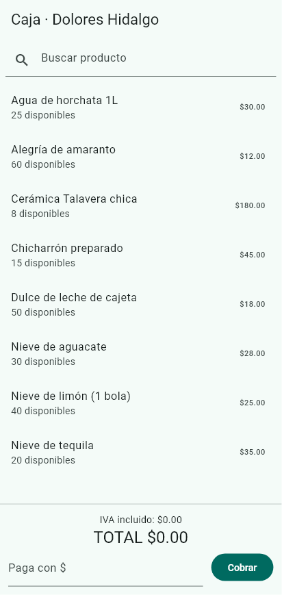
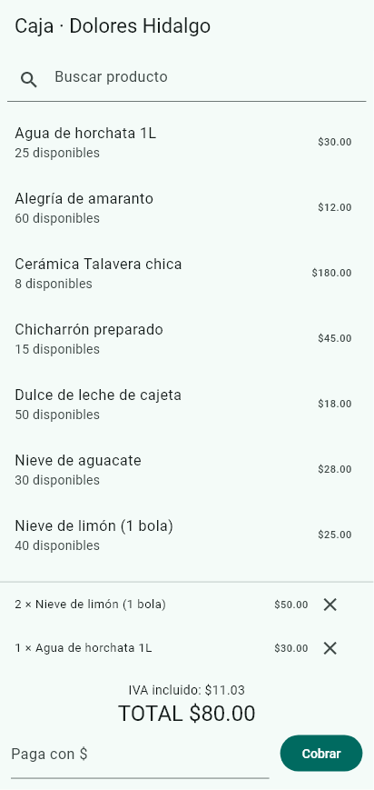
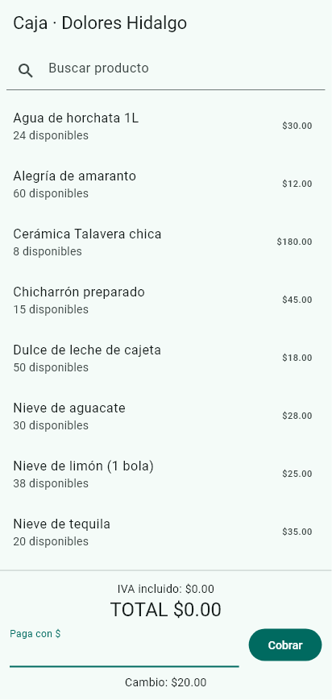
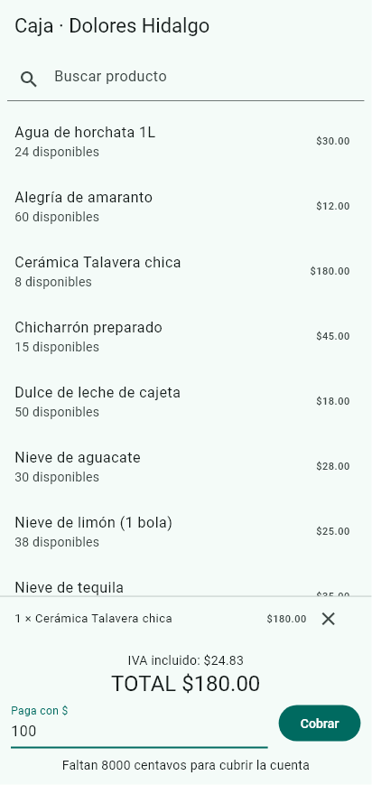

# 🍦 Punto de Venta Dolores — Flutter + SQLite con TDD

Punto de venta para una nevería de Dolores Hidalgo, construido **paso a paso con TDD** (Test-Driven Development) siguiendo el *Manual paso a paso con TDD · Punto de Venta*.

| | |
|---|---|
| **Materia** | Desarrollo Móvil Integral · UTNG |
| **Profesor** | José de Jesús Eduardo Barrientos Avalos |
| **Alumno** | Marco Antonio Rico Lopez |
| **Fecha** | 12/11/2026 |

La app guarda productos y ventas en una base **SQLite dentro del teléfono** (funciona sin internet), maneja todo el dinero en **centavos enteros**, desglosa el **IVA del 16 %**, calcula el **cambio**, descuenta el inventario dentro de una **transacción** y hace el **corte del día**.

## ✅ Resultado de las pruebas

```
flutter test     →  00:00 +23: All tests passed!
flutter analyze  →  No issues found!
```

| Archivo de pruebas | Capa | Pruebas | Estado |
|---|---|:---:|:---:|
| `test/dominio_test.dart` | Dominio (Dart puro) | 14 | ✅ |
| `test/datos_test.dart` | Datos (SQLite en memoria) | 9 | ✅ |
| **Total** | | **23** | ✅ |

De las 23 pruebas, **17 son las del manual** y **6 son de los retos ("Reto para ti") y del refactor**.

---

## 📸 Capturas

Pantalla real de la caja (`PantallaCaja` + `CajaViewModel` + SQLite con los productos de ejemplo).

| 1. Catálogo inicial | 2. Carrito con IVA |
|:---:|:---:|
|  |  |
| 8 productos de la nevería cargados con `sembrarEjemplos()` | 2 nieves de limón + 1 horchata → **TOTAL $80.00**, IVA incluido **$11.03** |
| **3. Cobro con cambio** | **4. Pago insuficiente** |
|  |  |
| Paga con $100 → **"Cambio: $20.00"**; la nieve baja de 40 a **38** y la horchata de 25 a **24** | Talavera de $180 pagando $100 → mensaje de negocio, **no se cobra** |

> Las capturas se generaron con la prueba de widgets [`capturas/generar_capturas_test.dart`](capturas/generar_capturas_test.dart): dibuja la pantalla real con una base SQLite en memoria, simula los toques del cajero, **verifica** los textos (`Cambio: $20.00`, `38 disponibles`, `Faltan 8000 centavos…`) y guarda cada pantalla como PNG. Para regenerarlas:
> ```
> flutter test capturas/generar_capturas_test.dart --update-goldens
> ```

---

## 🔴🟢 Evidencia del ciclo TDD

Cada regla se escribió **primero como prueba (ROJO)**, después el código mínimo para pasarla (**VERDE**). La salida de **cada corrida** de `flutter test` está en la carpeta [`evidencias/`](evidencias/).

| Ronda / ciclo | Prueba escrita primero | 🔴 Rojo: por qué falló | 🟢 Verde | Evidencia |
|---|---|---|:---:|---|
| 0 · Preparar | — (taller limpio) | — | 0 pruebas | [ronda0](evidencias/ronda0_flutter_test.txt) |
| 1.2 · Formatear pesos | `formatea centavos` | No existe `dinero.dart` | 1 | [rojo](evidencias/ronda1_paso1.2_ROJO.txt) · [verde](evidencias/ronda1_paso1.3_VERDE.txt) |
| 1.4 · Texto a centavos | `convierte texto a centavos`, `rechaza texto inválido` | `Method not found: 'pesosACentavos'` | 3 | [rojo](evidencias/ronda1_paso1.4_ROJO.txt) · [verde](evidencias/ronda1_paso1.4_VERDE.txt) |
| Reto R1 | `".5"` → 50 y `-250` → `-$2.50` | Pasa sin cambiar código | 4 | [reto](evidencias/ronda1_RETO.txt) |
| 2 · Producto | ida y vuelta a mapa, `copiarCon` | No existe `producto.dart` | 6 | [rojo](evidencias/ronda2_ROJO.txt) · [verde](evidencias/ronda2_VERDE.txt) |
| 3.1 · Sumar cantidades | `suma cantidades del mismo producto` | `Method not found: 'Carrito'` | 7 | [rojo](evidencias/ronda3_ciclo3.1_ROJO.txt) · [verde](evidencias/ronda3_ciclo3.1_VERDE.txt) |
| 3.2 · No vender lo que no hay | `no excede existencias` | `Expected: throws ExistenciasInsuficientesException` / `Actual: returned <null>` | 8 | [rojo](evidencias/ronda3_ciclo3.2_ROJO.txt) · [verde](evidencias/ronda3_ciclo3.2_VERDE.txt) |
| 3.3–3.4 · IVA y cambio | IVA 16 %, cambio, pago corto, carrito vacío | `getter 'ivaCentavos'` / `método 'cambio'` no definidos | 12 | [rojo](evidencias/ronda3_ciclos3.3-3.4_ROJO.txt) · [verde](evidencias/ronda3_ciclos3.3-3.4_VERDE.txt) |
| Reto R3 · Descuento | 10 % sobre $100 → $90, rango 0–100 | `método 'aplicarDescuento'` no definido | 14 | [rojo](evidencias/ronda3_RETO_descuento_ROJO.txt) · [verde](evidencias/ronda3_RETO_descuento_VERDE.txt) |
| 4.3 · SQLite | guarda y busca, código duplicado | No existe `repositorio_productos.dart` | 2 (datos) | [rojo](evidencias/ronda4_ciclo4.3_ROJO.txt) · [verde](evidencias/ronda4_ciclo4.3_VERDE.txt) |
| Refactor + Reto R4 | `sembrarEjemplos`, `bajoInventario` | — | 4 (datos) | [verde](evidencias/ronda4_REFACTOR_y_RETO.txt) |
| 5 · Transacción | cobrar, fallo sin descontar, corte, alerta, reto R5 | No existe `repositorio_ventas.dart` | 9 (datos) | [rojo](evidencias/ronda5_ROJO.txt) · [verde](evidencias/ronda5_VERDE.txt) |
| **Final** | Toda la suite | — | **23** | [final](evidencias/FINAL_flutter_test.txt) · [analyze](evidencias/flutter_analyze.txt) |

<details>
<summary>Ejemplo: Ciclo 3.2 en ROJO y luego en VERDE</summary>

```
00:00 +7: Carrito no excede existencias
00:00 +7 -1: Carrito no excede existencias [E]
  Expected: throws <Instance of 'ExistenciasInsuficientesException'>
    Actual: <Closure: () => void>
     Which: returned <null>
00:00 +7 -1: Some tests failed.
```
Después de validar **antes** de modificar el carrito:
```
00:00 +7: Carrito no excede existencias
00:00 +8: All tests passed!
```
</details>

---

## 🧪 Lista de pruebas realizadas

### Dominio — `test/dominio_test.dart` (14)

| # | Grupo | Prueba | Qué verifica |
|:-:|---|---|---|
| 1 | Dinero | formatea centavos | `0 → $0.00`, `5 → $0.05`, `123456 → $1,234.56` |
| 2 | Dinero | convierte texto a centavos | `"12.5" → 1250`, `"$1,200" → 120000`, `"0.07" → 7` |
| 3 | Dinero | rechaza texto inválido | `""` y `"1.2.3"` lanzan `FormatException` |
| 4 | Dinero | **reto R1** | `".5" → 50` y `-250 → "-$2.50"` |
| 5 | Producto | ida y vuelta a mapa | `aMapa()` / `desdeMapa()` conservan los datos |
| 6 | Producto | copiarCon | solo cambia el campo indicado (objeto inmutable) |
| 7 | Carrito | suma cantidades | 2 nieves = 1 renglón con cantidad 2, total $50.00 |
| 8 | Carrito | no excede existencias | lanza `ExistenciasInsuficientesException` |
| 9 | Carrito | desglosa IVA 16 % | $100.00 → IVA 1379 centavos y subtotal + IVA = total |
| 10 | Carrito | calcula cambio | paga $50 por $25 → cambio $25 |
| 11 | Carrito | pago insuficiente | lanza `PagoInsuficienteException` |
| 12 | Carrito | carrito vacío | lanza `CarritoVacioException` |
| 13 | Carrito | **reto R3** descuento | 10 % sobre $100 → $90.00; IVA baja a $12.41 |
| 14 | Carrito | **reto R3** rango | descuento < 0 o > 100 lanza `ArgumentError` |

### Datos — `test/datos_test.dart` (9, SQLite en memoria)

| # | Prueba | Qué verifica |
|:-:|---|---|
| 1 | guarda y busca producto | inserta y recupera por código, con `id` asignado |
| 2 | código duplicado | la restricción `UNIQUE` se traduce a `CodigoDuplicadoException` |
| 3 | sembrarEjemplos (refactor) | carga los 8 productos una sola vez; el filtro "nieve" da 3 |
| 4 | **reto R4** bajoInventario | con límite 5 devuelve 2: alegría (2) y nieve (5); la horchata (50) no |
| 5 | cobrar descuenta inventario | 2 de 5 nieves pagando $100 → cambio $50, quedan 3 |
| 6 | si falla el cobro NO se descuenta | pago corto → excepción y el inventario sigue en 5 |
| 7 | corte del día | 2 ventas hoy → 2 ventas, total $75.00 |
| 8 | bajo inventario alerta | 1 producto con existencias ≤ 5 |
| 9 | **reto R5** | vender 5 nieves y luego 1 más → `ExistenciasInsuficientesException` por la revalidación **dentro de la transacción**; inventario 0 y solo 1 venta |

---

## 🏆 Retos individuales

- **Ronda 1:** `pesosACentavos('.5')` da 50 y `formatearPesos(-250)` da `-$2.50` **sin cambiar código**.
- **Ronda 3 · Descuento:** se agregó `aplicarDescuento(int porcentaje)` al `Carrito` (prueba primero). El descuento se redondea con enteros y el **IVA se desglosa del total ya con descuento**: de $13.79 baja a **$12.41** (9000 × 16 / 116). Subtotal + IVA sigue cuadrando exacto.
- **Ronda 4 · bajoInventario():** con un producto de 2 y otro de 50 devuelve **2** productos, porque la nieve del `setUp` tiene 5 y la condición es `existencias <= 5`.
- **Ronda 5:** al vender las 5 nieves e intentar 1 más, `cobrar()` lanza **`ExistenciasInsuficientesException`**: el carrito validó con una "foto" vieja del producto, pero la transacción revalida contra la base.

## 🛠️ Problemas encontrados y solución

| Problema | Causa | Solución |
|---|---|---|
| La 2.ª prueba de datos fallaba con *"Ya existe un producto con el código NV-001"* | `openDatabase` usa `singleInstance: true` por omisión: abrir `inMemoryDatabasePath` otra vez devolvía **la misma** base y el `setUp` chocaba con los datos de la prueba anterior | `BaseDatos.abrir` usa `singleInstance: ruta == null` y se agregó `tearDown(() => db.close())`. Ahora cada prueba recibe una base nueva |
| `flutter test` no compilaba `sqlite3` (*Failed to canonicalize path… OS error 122*) | `sqflite_common_ffi 2.4.x` usa `sqlite3 3.x` con *build hooks* que fallan en rutas largas de Windows | Se fijó `sqflite_common_ffi: ">=2.3.0 <2.4.0"` |

## ☑️ Checklist de calidad

- [x] Todo el dinero está en centavos enteros; ningún `double` en el dominio.
- [x] El dominio no importa Flutter ni sqflite.
- [x] Cada regla de negocio nació de una prueba roja.
- [x] Cobrar usa una transacción y se probó el caso de fallo.
- [x] Los errores técnicos se traducen a excepciones de negocio con mensaje claro.
- [x] La pantalla no contiene reglas de negocio.
- [x] `flutter test` termina completamente en verde.

## 📁 Estructura

```
lib/
  dominio/        reglas del negocio (Dart puro): dinero, producto, carrito, venta, excepciones
  datos/          SQLite: base_datos, repositorio_productos, repositorio_ventas
  presentacion/   caja_viewmodel, pantalla_caja
  main.dart       composition root
test/
  dominio_test.dart   datos_test.dart
capturas/         generador de capturas + PNG
evidencias/       salida de cada corrida de flutter test (rojo / verde)
docs/             documento de evidencia (PDF)
```

## ▶️ Cómo ejecutar

```bash
flutter pub get
flutter test        # 23 pruebas
flutter analyze
flutter run         # en un teléfono o emulador Android
```
